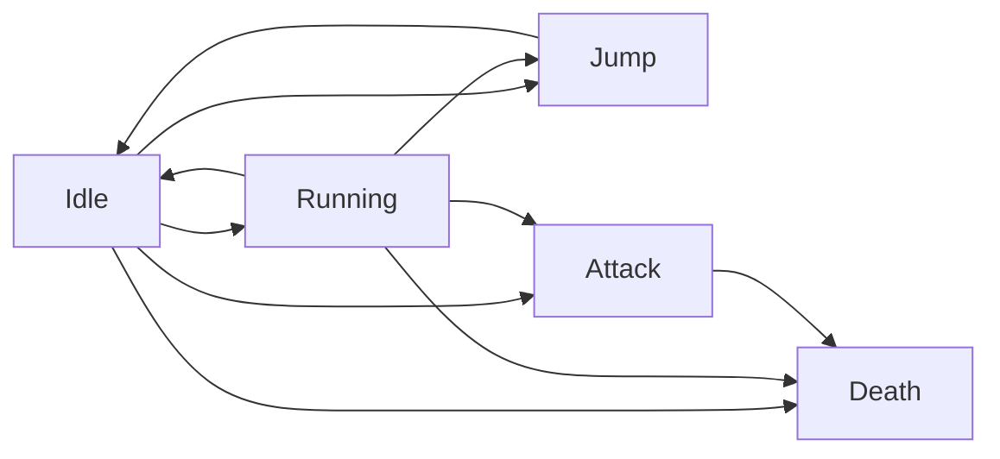

# Character Controller
>Not for public release.

Technical documentation for the character in Remnant Isles.
 - Overall scene structure
 - Collision
 - Inputs
 - Movement
 - Jumping
 - Attacking
 - Animations


##  Scene Structure

The node tree of the character.

- KinematicBody2D (Player)
  - Sprite
  - Node (Colliders)
     - CollisionShape2D (Col_stand_capsule) - CapsuleShape2D
     - CollisionShape2D (Col_stand_ray) - RayShape2D
  - Node (HitBoxes)
     - Area2D (Box_basic_attack)
	     - CollisionShape2D
     - Area2D (Box_special_attack)
	     - CollisionShape2D
  - Camera2D
  - AnimationPlayer
  - AnimationTree

## Collision
The capsule collision shape is for the main body of the character.
The ray collision shape is for the characters 'feet', assisting with movement along surfaces and up/down slopes.

## Inputs
Actions will be dictated based off of the Godot Input Map under **Project -> Project Settings -> Input Map**

|Action|Input Map Name|Default Keyboard|Default Game Pad|
|-|-|-|-|
|Move Left|move_left|A|Right Analog, Left|
|Move Right|move_right|D|Right Analog, Right|
|Jump|jump|Space|A button|
|Crouch|crouch|S|B button|
|Attack|attack_basic|L|X button|
|Sp. Attack|attack_special|;|Y button|

## Behaviors

Input flags will be handled in an `input()` function. Flags will then be used for logic in the `_process()` function.

### Movement
#### Grounded
While move left or move right is held the character's x velocity will accelerate based upon an `acceleration` value. Otherwise the character's velocity will be multiplied by a value less than 1 in order to decelerate until a `minimum threshold` value is reach, then the character's velocity will be set to 0.

```javascript
func input():
	...
	direction = Input.is_action_pressed("move_right") - Input.is_action_pressed("move_left")

func _process(delta):
	input()
	...
	if direction == 0 and velocity.x > 0:
		velocity.x *= deceleration
		if velocity.x <= minimum_threshold:
			velocity.x = 0
	else:
		state_machine.travel("run")
		velocity.x += direction * acceleration * delta
		if direction > 0:
			sprite.flip_h = false
		if direction < 0:
			sprite.flip_h = true
```

#### Airborn
>Not determined

### Jump
When jump is pressed and the character is able to jump, the character's y velocity will be set to a value determined by `jump power`. While jump is held the character's specific gravity will be kept at a `jumping gravity` and once released will be set to a `non-jumping gravity`. This create a "Hold for height" functionality. Once the character has landed and after a timer has completed jumping will be re-enabled.

Snap vector for `move_and_slide()` may need to be modified for proper jumping.

```javascript
func input():
	...
	if Input.is_action_just_pressed("jump") && can_jump:
		jump = true
	if is_action_pressed("jump") && !is_on_floor() && velocity.y < 0:
		gravity = jumping_gravity
	else:
		gravity = normal_gravity

func _process(delta):
	input()
	...
	if jump:
		state_machine.travel("jump")
		snap_vector = Vector2()
		can_jump = false
		velocity.y = -jump_force
	velocity.y += gravity
```

### Crouch
Movement speed will be set to a `crouched movement` value.

```javascript
func input():
	...
	crouch = Input.is_action_pressed("crouch") && is_on_floor()

func _process():
	input()
	...
	if crouch:
		state_machine.travel("crouch")
		acceleration = crouch_acceleration
```

### Attack
Plays attack animations. Enabling / Disabling of hitboxes can be done in animations.

```javascript
	func input():
		...
		basic_attack = Input.is_action_pressed("attack_basic")

	func _process(delta):
		...
		if basic_attack:
			state_machine.travel("basic_attack")

	func _on_Box_basic_attack_body_entered(body):
	if body.is_in_group("enemy"):
		body.take_damage()
```
## Animation

Character is on the ground and not moving -> Idle
Character is on the ground and moving -> Running
Character is on the ground and pressed the attack button -> Attack
Character's hit points have been reduced to 0 -> Death
Character is able to jump and has pressed the jump button -> Jump

**Note:** If you don't understand what a State Machine is, here is a [helpful link](http://kidscancode.org/godot_recipes/animation/animation_state_machine/) that explains it.


### Animation Tree

