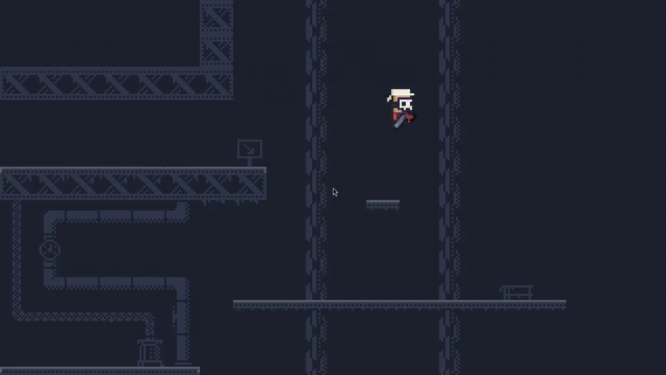

# Vulker

Vulker is a 2D platformer prototype I built in Godot. The playable level pairs movement and jumping with industrial scaffolding and narrow platforms.

**Playable prototype**

## Run the game

Open `project.godot` in Godot 3.5.3, let the editor import the assets, and run the project. The main scene is `World.tscn`. Use A and D to move and W or Space to jump.

The gameplay clip was captured from this project during migration.
